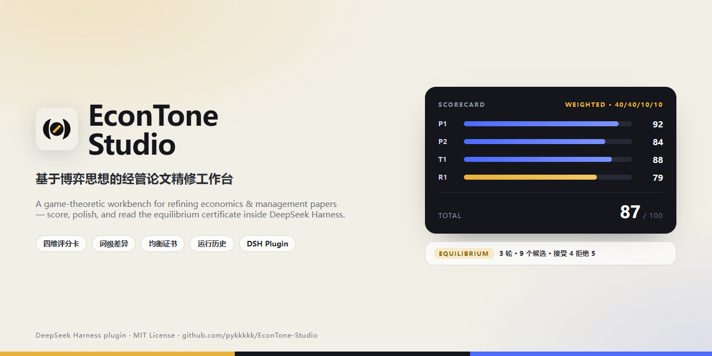
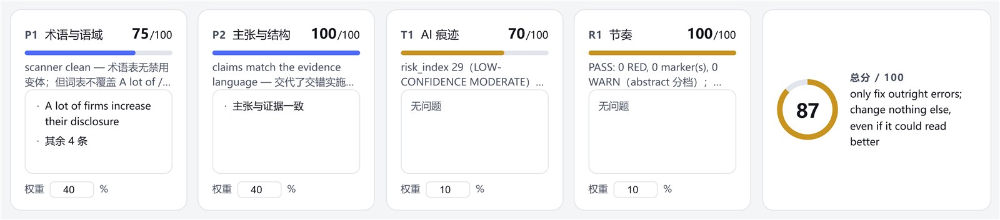
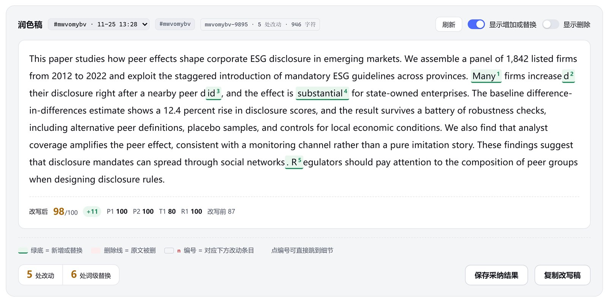
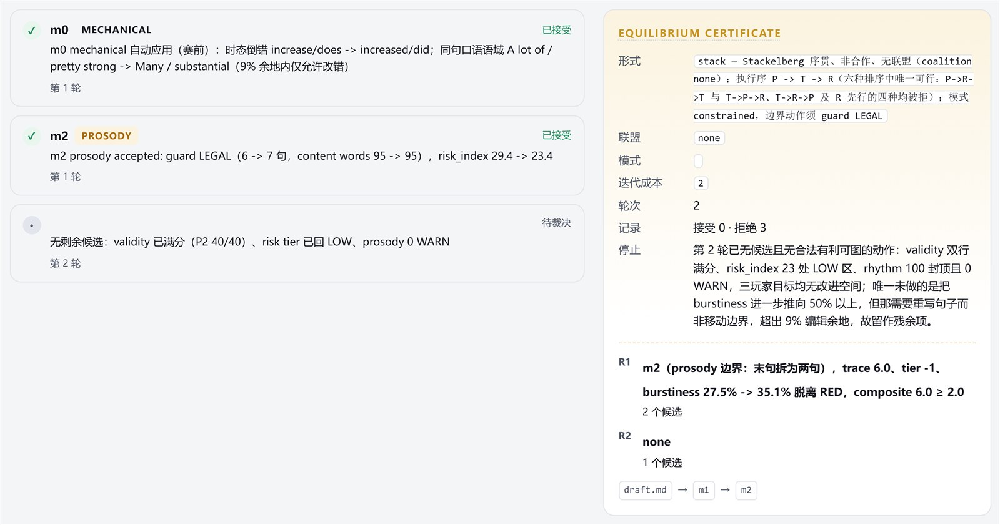
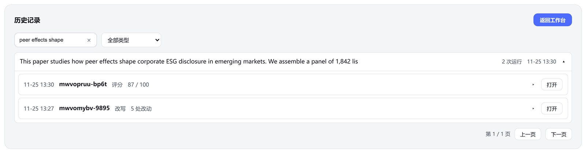

# EconTone Studio

[](https://github.com/pykkkkk/EconTone-Studio/releases)
[](https://github.com/deepseek-ai/deepseek-harness)
[](LICENSE)



[简体中文](README.zh-CN.md) ｜ English

A DeepSeek Harness panel that turns the [EconTone](https://github.com/pykkkkk/EconTone) measurement skills into a
workbench: score, polish, and read the equilibrium certificate.









## Install

```powershell
git clone https://github.com/pykkkkk/EconTone-Studio.git
```

```json
"dependencies": {
  "econtone-studio": "link:D:/path/to/EconTone-Studio"
},
"dsh": {
  "profile": {
    "bundles": ["@deepseek-ai/dsh-base", "@deepseek-ai/dsh-web-app", "econtone-studio"]
  }
}
```

Reload DSH. The engine reads skills from `~/.dsh/skills`; override with `engineRoot`.

## Layout

```
├─ index.js                 host: routes, runs, state sync
├─ ui/econtone-studio.html  UI source (the only file to edit by hand)
├─ engine/studio_bridge.py  bridge to the EconTone skill scripts
├─ lib/                     shipped bundle (committed; install needs no build)
├─ build/build_lib.py       sources -> lib/
├─ tests/                   node:test smoke tests
└─ docs/                    architecture, build notes, images
```

## Develop

```powershell
python build/build_lib.py
node --test tests/smoke.mjs
```

See [docs/ARCHITECTURE.md](docs/ARCHITECTURE.md) · [docs/BUILDING.md](docs/BUILDING.md) · [CHANGELOG.md](CHANGELOG.md) · [CHANGELOG-DEV.md](CHANGELOG-DEV.md) · [CONTRIBUTING.md](CONTRIBUTING.md) · [SECURITY.md](SECURITY.md)

## License

[MIT](LICENSE)
