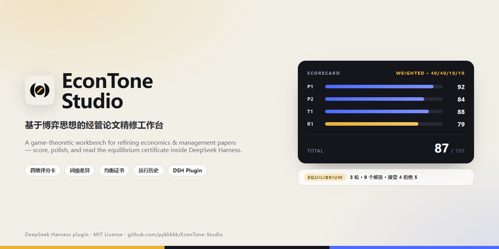
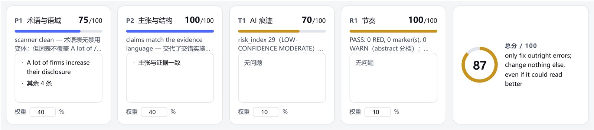
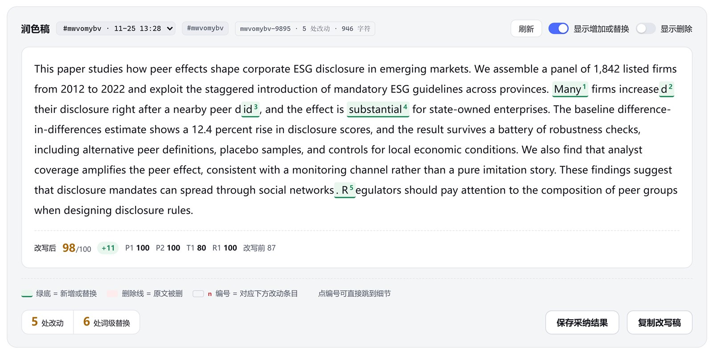
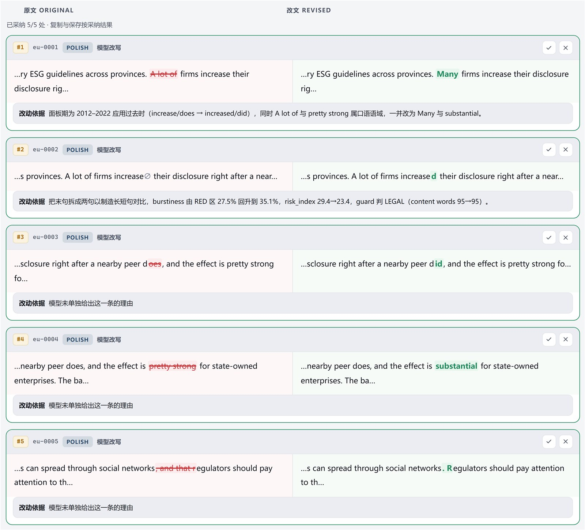
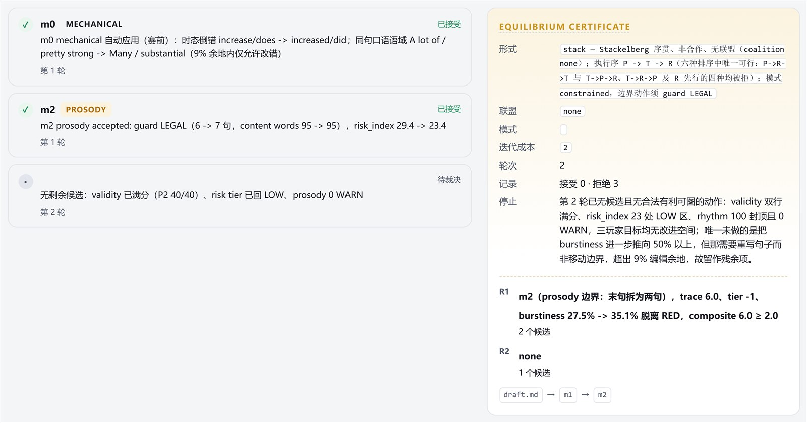
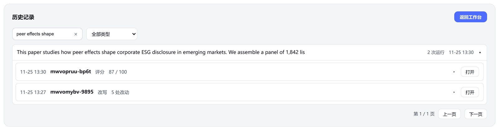

# EconTone Studio

[](https://github.com/pykkkkk/EconTone-Studio/releases)
[](https://github.com/deepseek-ai/deepseek-harness)
[](LICENSE)



English ｜ [简体中文](README.zh-CN.md)

一个基于博弈思想的经管论文精修工作台，运行在 [DeepSeek Harness](https://github.com/deepseek-ai/deepseek-harness) 里。











## 安装

```powershell
git clone https://github.com/pykkkkk/EconTone-Studio.git
```

```json
"dependencies": {
  "econtone-studio": "link:D:/path/to/EconTone-Studio"
},
"dsh": {
  "profile": {
    "bundles": ["@deepseek-ai/dsh-base", "@deepseek-ai/dsh-web-app", "econtone-studio"]
  }
}
```

重新加载 DSH。引擎默认从 `~/.dsh/skills` 读取 skill，可用 `engineRoot` 覆盖。

## 目录

```
├─ index.js                 宿主：接口、运行调度、状态同步
├─ ui/econtone-studio.html  界面源文件（唯一手改入口）
├─ engine/studio_bridge.py  调用 EconTone skill 脚本的桥
├─ lib/                     发布产物（已提交，安装无需构建）
├─ build/build_lib.py       源码 → lib/
├─ tests/                   node:test 快速测试
└─ docs/                    架构、构建说明、图片
```

## 开发

```powershell
python build/build_lib.py
node --test tests/smoke.mjs
```

详见 [docs/ARCHITECTURE.md](docs/ARCHITECTURE.md) · [docs/BUILDING.md](docs/BUILDING.md) · [CHANGELOG.md](CHANGELOG.md) · [CHANGELOG-DEV.md](CHANGELOG-DEV.md) · [CONTRIBUTING.md](CONTRIBUTING.md) · [SECURITY.md](SECURITY.md)

## 许可

[MIT](LICENSE)
